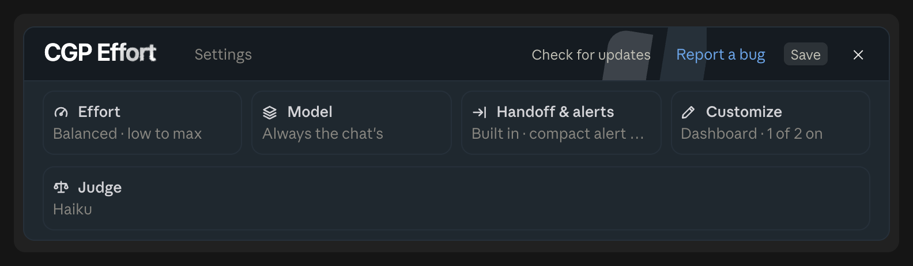

# CGP Effort

A Claude Code plugin by [Crypto Gameplan](https://github.com/crypto-gameplan). It picks the reasoning effort for every
prompt, so quick questions run at **Low** and hard jobs at **High**, without you touching the Effort control. One bar
above the prompt shows the effort, how full the chat is and how long the prompt cache stays warm, and compacts or hands
off a heavy chat in one click.

<p align="center"></p>

How everything works, in detail: [docs/GUIDE.md](docs/GUIDE.md). The same as a PDF is attached to every release
([latest](https://github.com/crypto-gameplan/cgp-effort/releases/latest/download/CGP-Effort-Guide.pdf)). In Claude Code you can
also just ask, for example "why does the bar say Paused?": the plugin brings a skill that answers from the guide.

## Install

CGP Effort comes from the Crypto Gameplan marketplace ([crypto-gameplan/cgp-marketplace](https://github.com/crypto-gameplan/cgp-marketplace)), which lists all our Claude Code plugins. In Claude Code, type these two lines in the chat box:

```text
/plugin marketplace add crypto-gameplan/cgp-marketplace
```

```text
/plugin install cgp-effort@crypto-gameplan
```

Or in a terminal:

```bash
claude plugin marketplace add crypto-gameplan/cgp-marketplace && claude plugin install cgp-effort@crypto-gameplan
```

Then run `/reload-plugins` (or restart Claude Code). A short setup opens above the prompt. Run `/cgp-effort setup` to go
through it again, or change anything later in ⚙.

New versions come to you: a card above the prompt offers **Update** or **Later**, and Update loads the new version in the
chat you pressed it in.

CGP Effort runs on macOS, Linux and Windows, in the desktop app and in the terminal.

## How it decides

Before each prompt goes out, a small, cheap model reads it and picks the effort:

- **Haiku 5.5** (default) runs on your own Claude login. No key needed, about a second per prompt.
- **Jev** (optional) is TypeSafe's faster judge, about a quarter of a second. It needs a [TypeSafe](https://typesafe.ai)
  key. With a key, Jev answers first and Haiku steps in whenever Jev is unsure, slow or down.

Short follow-ups such as "go", "ok" or "yes" keep the effort already picked and ask no judge. If you name a level
yourself ("max effort"), it runs as you said. If you change the effort in the app, Auto switches off and says so: your
choice always wins.

To switch Auto effort off for good without uninstalling, turn off **Auto effort** in Settings → Effort (or set
`autoEffort` to `off` under `/plugin`). The bar, cache timer, compact, handoff and alerts keep working.

Effort only changes on Opus 5.5 and Sonnet 5.5. On other models a change of effort between requests rewrites most of
the prompt cache, which costs more than it saves, so Auto pauses there and the bar says `Paused`.

## What the bar shows

| On the bar | Means |
|---|---|
| **High · Opus** | the effort picked for this prompt, and the model the chat runs on. `Deciding` while the judge thinks |
| **◔ 38%** | how full the chat's context is |
| **cache 59:00** | time until the prompt cache goes cold; after that the next message pays full price to reread the chat |
| **Auto** | the judge on or off |
| **Compact** | compacts the chat. It turns into **Handoff** when Haiku says a fresh chat would serve you better |
| **⚙** | settings |

**Keep cache warm** (Settings → Handoff & alerts, off by default): on a big chat, a one-word request goes out just
before the cache would go cold, for 1, 2 or 3 hours after your last message. It reads the chat from cache, about a tenth
of the price of rereading it, so it pays when you come back within those hours. `/cgp-effort stats` shows how often it
ran and what it took.

**Animations** can be switched off in Settings → Customize: the bar and its alerts then stand still.

**With [CGP Crew](https://github.com/crypto-gameplan/cgp-crew)** installed, a running crew shows in a row above the bar:
its title, where the lead stands ("Reviewing 1/3"), one segment per task in its role's colour, a Crew button that
opens the crew panel and a ✕ that hides the row. Without a running crew the row is gone. In the Minimal look CGP Crew
draws its own bar instead.

The bar also warns when the cache has gone cold on a big chat, when the context is getting full, when a 5-hour or weekly
limit passes 80% (with a Save mode that caps effort at Medium), and when the judge stops answering.

**Handoff** writes a summary of the chat and carries on in a clean one. **Quick** takes a few seconds; **Full** checks
git and saves the handoff in your system's temp folder, never in the project (or runs your own skill). Each handoff
marks what the chat did not check as unverified, links specs, issues and commits instead of copying them, names the
skills the next chat should use, and leaves out keys and personal data. **Compact** is written by Haiku 5.5 by default, at
a fraction of the chat model's price; if Haiku fails, Claude Code compacts as usual.

<p align="center"></p>

## Keys and trust

- The default judge needs **no key**: Haiku runs on your own Claude login.
- A key is only needed for Jev. Paste it in the setup or the Judge card, or enter it with
  `/plugin configure cgp-effort@crypto-gameplan`. Either way it goes to Claude Code's secure storage (the Keychain on
  macOS), never to a plain file. If Claude Code cannot store it there, the key is dropped and you are told to use
  `/plugin configure`. The field shows dots while you type and, once saved, only the key's last four characters. Use a
  key with a spending limit if TypeSafe offers one.
- Your prompt goes to the judge you use: Haiku through your Claude login, and with a key also to TypeSafe. Nothing else
  is sent anywhere.
- Like any Claude Code plugin, this one runs code on your machine. All of it is in [`hooks/`](hooks/). The programs it
  starts are `claude` (to update or uninstall itself when you press those buttons), `git` (to see if a new version is
  out) and, on Update, a plain file copy of the new version into the folder your open chat runs from.

## In the terminal

CGP Effort draws in the terminal too. If `/cgp-effort` says the plugin is not loaded after a restart, add this to
`~/.claude/settings.json` and restart:

```json
{ "env": { "CLAUDE_CODE_ENABLE_FUNCTION_HOOKS": "1" } }
```

Below 90 columns the bands leave their art out. In a terminal too narrow for the bar's text and its buttons on one
line, the buttons move to a second line inside the bar.

## Commands

| Command | Does |
|---|---|
| `/cgp-effort settings` | opens the settings panel |
| `/cgp-effort setup` | runs the setup again |
| `/cgp-effort auto` | Auto on or off |
| `/cgp-effort handoff` / `handoff full` | hands off without the bar; text after it says what the next chat is for |
| `/cgp-effort stats` | what the prompts Auto steered cost this session, per effort, and what the judge took |
| `/cgp-effort cold`, `swamp`, `hot`, `down` | shows that warning now, to try it |
| `/cgp-effort bench` | scores each judge you have on the labelled prompts in [`bench/judge-cases.json`](bench/judge-cases.json) |
| `/cgp-effort debug` | what the plugin sees, and the model and effort the last request ran on |
| `/cgp-effort update` | checks for a new version now |

## Develop

```bash
claude plugin validate .
claude plugin test .
claude --plugin-dir .
```

- `tools/release.sh --files <paths> -- "<subject>"` runs the tests, bumps the patch version, commits and pushes to `main`
  (the dev channel, `cgp-effort@crypto-gameplan-dev`). It reaches no customer.
- `tools/publish.sh "<what's new>" "<detail>"` bumps the minor version, writes `public.json`, moves the `stable` branch
  and creates a GitHub release. Every customer then gets the update card.
- `tools/render-band` draws the bar the way the desktop app does, without opening it; the images here come from it.
- `tools/sync-version.mjs` keeps the version line of `docs/GUIDE.md` on the plugin's version; the release scripts run it and
  CI checks it.
- CI runs the tests and the release gate on macOS, Linux and Windows.

## Origin and license

CGP Effort is based on [effortless](https://github.com/HeyCubit/effortless) by HeyCubit, used under the MIT license.
Crypto Gameplan changed the name, the look and the release channel. MIT licensed, see [LICENSE](LICENSE).
